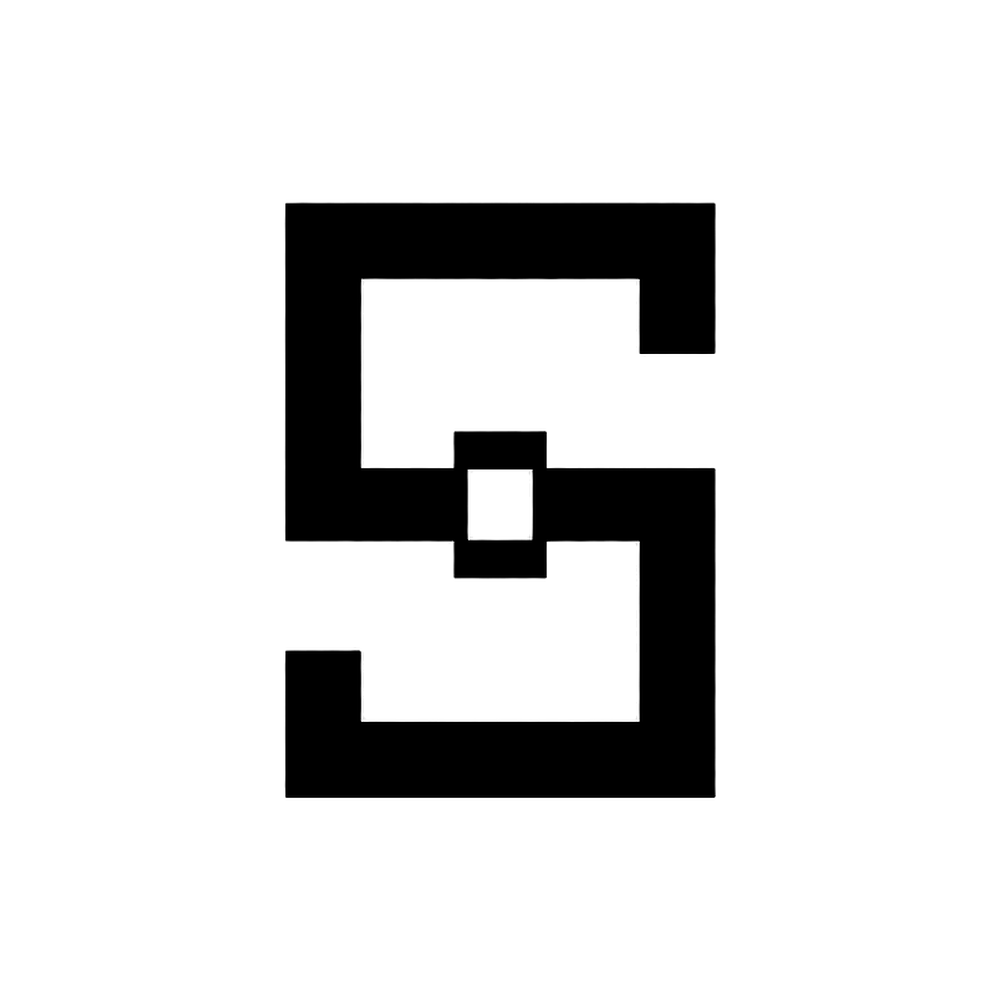

# اسکیرک

[English](README.md)

اسکیرک گوشی یا رایانهٔ شما را به یک دستگاه خروجی که خودتان اداره می‌کنید وصل می‌کند. برنامه و خروجی، ترافیک TCP و UDP را به‌صورت رمزگذاری‌شده از طریق فایل‌های گوگل درایو جابه‌جا می‌کنند. بسته به سیستم‌عامل می‌توانید از VPN دستگاه یا پروکسی محلی استفاده کنید.

**پروفایل دارید؟** برنامهٔ مخصوص دستگاهتان را نصب کنید، متن کامل پروفایل را که با `skirk:` شروع می‌شود جای‌گذاری و ذخیره کنید و دکمهٔ اتصال را بزنید. ورود به گوگل را صاحب خروجی یک‌بار انجام می‌دهد. پروفایل حکم رمز عبور را دارد. [راهنمای تصویری نصب](docs/install.fa.md) · [دانلود](https://github.com/ShahabSL/Skirk/releases/latest)

**می‌خواهید خروجی بسازید؟** یک دستگاه همیشه‌روشن، حساب گوگل و اعتبارنامهٔ Desktop از پروژهٔ شخصی Google Cloud لازم دارید. پیش از دادن دسترسی درایو، برنامهٔ OAuth خود را منتشر کنید تا دسترسی مشمول انقضای هفت‌روزهٔ حالت آزمایشی نشود. [تنظیم گوگل با تصویر](docs/personal-google-setup.fa.md) · [راه‌اندازی خروجی](docs/install.fa.md)

| سیستم‌عامل | کلاینت | خروجی |
| --- | --- | --- |
| اندروید | [VPN دستگاه (نسخهٔ یونیورسال)](https://github.com/ShahabSL/Skirk/releases/download/android-v0.1.59-3/skirk-android-universal.apk) | — |
| iOS | تونل شبکه | — |
| ویندوز | پروکسی در برنامه یا خط فرمان، VPN برای x64 | خط فرمان |
| macOS | پروکسی در برنامه یا خط فرمان | خط فرمان |
| لینوکس | پروکسی، VPN روی سیستم‌های پشتیبانی‌شده، خط فرمان | خط فرمان و سرویس systemd |

رفت‌وبرگشت از درایو به درخواست‌ها تأخیر اضافه می‌کند. تماس و انتقال فایل می‌توانند هم‌زمان باشند، اما بسته‌های صدا و تصویر گاهی دیرتر از زمان پخش می‌رسند. ظرفیت به شبکه، خروجی، نوع استفاده و سهمیهٔ گوگل بستگی دارد. [نتایج و ظرفیت](docs/install.fa.md#ظرفیت)

برای ارتقا، خروجی و کلاینت‌ها را با هم به‌روزرسانی کنید. [راهنمای مهاجرت به انگلیسی](docs/mux-v5-migration.md) · [تنظیمات پیشرفته](docs/setup.md)

سازندهٔ اسکیرک شهاب لواسانی است. این پروژه مستقل از گوگل است. [مجوز MIT](LICENSE) · [مجوز اجزای دیگر](third_party/) · [شرایط استفاده](DISCLAIMER.md) · [امنیت](SECURITY.md)

## حمایت از پروژه

کمک‌های مالی صرف آزمایش و نگهداری پروژه می‌شوند.

- USDT: `0x5d0b46d821910a5a5503de78e230f9a5e9c52c2f`
- BTC: `bc1q8qsxlp7pzgdqkhu2aj5ss3krnkrecyrh6hedpj`
- ETH: `0x5d0b46d821910a5a5503de78e230f9a5e9c52c2f`
- TON: `UQAO9dEwEVIrrTwoWzCd3Rksb6r3qFSs80Xa7yp3nkO4CPyp`
