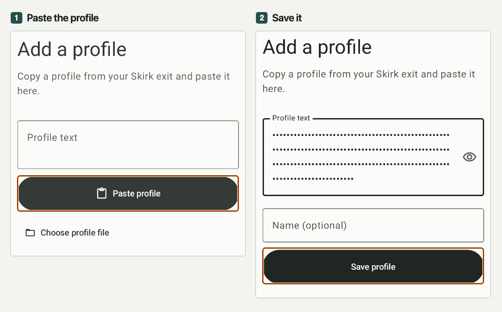
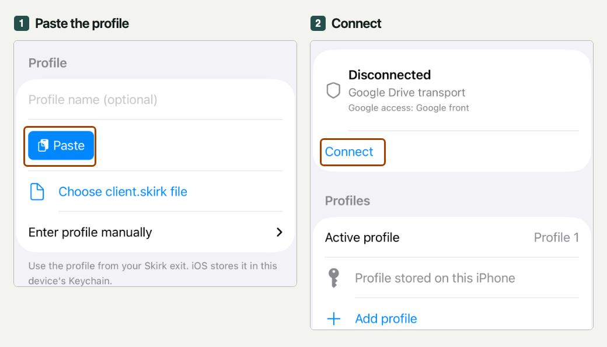
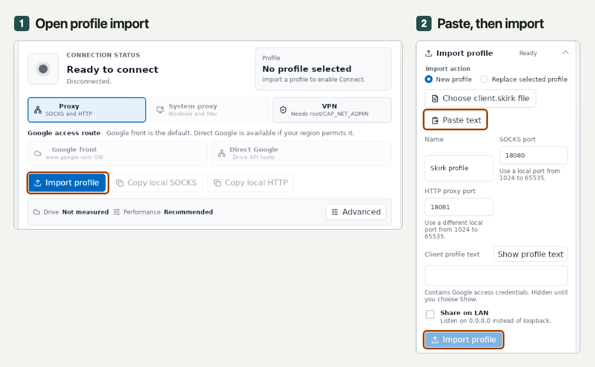

# نصب و راه‌اندازی اسکیرک

[English](install.md)

## راه‌اندازی خروجی

۱. در مرورگر رایانهٔ خودتان، Drive API را در پروژهٔ گوگل فعال کنید، برنامهٔ OAuth را منتشر کنید و یک **Desktop app** بسازید. پنجره‌ای را که **Client ID** و **Client secret** را نشان می‌دهد باز نگه دارید. این مرحله را فقط صاحب خروجی انجام می‌دهد. [راهنمای تصویری گوگل](personal-google-setup.fa.md)

۲. ترمینال دستگاهی را باز کنید که قرار است به‌عنوان خروجی روشن بماند. اگر سرور راه دور دارید، ابتدا با SSH به آن وصل شوید. برای نصب روی لینوکس، دستورهای زیر را در همان ترمینال اجرا کنید. محل نصب برای کاربر عادی `~/.local/bin` و برای کاربر ریشه `/usr/local/bin` است.

```sh
curl -fL https://raw.githubusercontent.com/ShahabSL/Skirk/v0.1.56/install.sh -o install-skirk.sh
sh install-skirk.sh --version v0.1.56
skirk version
```

۳. در ترمینال خروجی، راه‌اندازی را شروع کنید.

```sh
skirk setup init --out skirk-kit
```

۴. وقتی اسکیرک روش ورود اطلاعات را می‌پرسد، Enter را بزنید تا گزینهٔ ۱ (**Paste**) انتخاب شود. **Client ID** را از پنجرهٔ گوگل کپی کنید، در ترمینال جای‌گذاری کنید و Enter را بزنید. در پرسش بعدی **Client secret** را جای‌گذاری کنید و دوباره Enter را بزنید. هنگام جای‌گذاری، کلید روی صفحه نمایش داده نمی‌شود. اسکیرک فایل اعتبارنامه را روی خروجی می‌سازد.

۵. پیوندی را که اسکیرک نشان می‌دهد در مرورگر خودتان باز کنید. با حساب گوگلی که قرار است مالک صندوق باشد، دسترسی درایو را تأیید کنید. در اتصال SSH ممکن است صفحهٔ نهایی با نشانی localhost باز نشود. **کل نشانی** را از نوار آدرس مرورگر کپی کنید و در همان ترمینالی که منتظر پاسخ است جای‌گذاری کنید. این نشانی محرمانه است.

۶. فایل `skirk-kit/exit.json` را روی خروجی نگه دارید. برای دیدن پروفایل در ترمینال خصوصی خودتان، `cat skirk-kit/client.skirk` را اجرا کنید. در PowerShell دستور `Get-Content skirk-kit/client.skirk` را بزنید. کل خطی را که با `skirk:` شروع می‌شود کپی کنید و به‌صورت خصوصی برای افرادی بفرستید که قرار است از خروجی استفاده کنند. آن‌ها این متن را در برنامهٔ اسکیرک جای‌گذاری می‌کنند.

در لینوکس، راه‌انداز می‌تواند سرویس systemd را نصب و اجرا کند. با `skirk service status` وضعیت آن را ببینید. اگر سیستم شما systemd ندارد، به دستور راه‌اندازی `--start-exit=false` اضافه کنید. سپس خروجی را با `skirk serve-exit --config skirk-kit/exit.json` اجرا کنید و ترمینال را باز نگه دارید.

**خروجی روی مک یا ویندوز.** بستهٔ خط فرمان متناسب با سیستم‌عامل و پردازنده را بگیرید و مقدار SHA-256 را با `SHA256SUMS` تطبیق دهید. آن را در یک پوشهٔ خصوصی در حساب کاربری خود از حالت فشرده خارج کنید و ترمینال را در همان پوشه باز کنید. اسکیرک فایل اعتبارنامه و کیت را همان‌جا ذخیره می‌کند. دستور راه‌اندازی مخصوص سیستم‌عامل خود را بزنید. پس از پایان راه‌اندازی، دستور اجرای خروجی را بزنید و ترمینال را باز نگه دارید. [دانلود](https://github.com/ShahabSL/Skirk/releases/latest)

| سیستم‌عامل خروجی | راه‌اندازی اولیه | اجرای خروجی |
| --- | --- | --- |
| macOS | `./skirk setup init --out skirk-kit --start-exit=false` | `./skirk serve-exit --config skirk-kit/exit.json` |
| ویندوز (PowerShell) | `.\skirk.exe setup init --out skirk-kit --start-exit=false` | `.\skirk.exe serve-exit --config skirk-kit/exit.json` |

## اتصال گوشی یا رایانه

۱. برای اندروید می‌توانید APK با برچسب universal را بگیرید. برای دسکتاپ بستهٔ مخصوص سیستم‌عامل و پردازنده را انتخاب کنید. برای مک‌های سری M، نسخهٔ arm64 مناسب است. در آیفون از نسخه‌ای استفاده کنید که از طریق اپل به آن دسترسی دارید.

۲. پروفایل را از ابتدای `skirk:` تا آخر کپی کنید. در بخش ورود پروفایل، گزینهٔ جای‌گذاری را بزنید و آن را ذخیره کنید.

۳. پروفایل را انتخاب کنید و **Connect** را بزنید. در حالت VPN، درخواست سیستم‌عامل را تأیید کنید. در حالت پروکسی، نشانی پروکسی را در برنامهٔ موردنظر وارد کنید. با آزمون خروجی داخل اسکیرک بررسی کنید که ارتباط برقرار شده است.

| اندروید | آیفون | دسکتاپ |
| --- | --- | --- |
|  |  |  |


برای کلاینت بدون رابط گرافیکی، `skirk serve-client --config ./client.skirk` را اجرا کنید. در برنامهٔ مصرف‌کننده، پروکسی SOCKS5 را روی `127.0.0.1:18080` تنظیم کنید و در صورت امکان، حل نام را به پروکسی بسپارید.

## ظرفیت

در یکی از آزمایش‌های واقعی درایو، ۱۲۰ کاربر پشت یک دروازهٔ مشترک هرکدام یک فایل ۱ MiB فرستادند و گرفتند و یک درخواست HTTPS را کامل کردند. دو تماس هم‌زمان در همان آزمایش برقرار نشد. در آزمایشی جداگانه با هشت کاربر و دو تماس فعال، هر شانزده انتقال ۱۶ MiB کامل شد و مجموع سرعت رفت‌وبرگشت فایل‌ها ۷۳٫۳۳ مگابیت‌برثانیه بود. در ضعیف‌ترین جهت تماس، ۷۸٫۸٪ صدای اصلی و ۵۷٫۹٪ ویدیو در مهلت پخش ۱٫۵ ثانیه‌ای رسید. این عددها به بار کاری و شبکهٔ همان آزمایش مربوط‌اند.

کیت جدید UDP و DNS خروجی را فعال می‌کند. IPv6 پس از بررسی مسیر خروجی فعال می‌شود. تنظیم پیش‌فرض خروجی چهار مسیر مستقل UDP دارد و هر مسیر می‌تواند چند نشست را حمل کند. برای تخمین ظرفیت خودتان، هنگام انتقال فایل کیفیت تماس دریافتی و سهمیهٔ پروژه را بررسی کنید. [سهمیهٔ درایو](https://developers.google.com/workspace/drive/api/guides/limits)

## نگهداری

اگر دسترسی منقضی شد، پس از انتشار برنامهٔ OAuth با همان حساب و همان اعتبارنامه دسترسی را تمدید کنید، خروجی را دوباره راه بیندازید و پروفایل تازه را وارد کنید. [راهنمای تمدید](personal-google-setup.fa.md)

برای ارتقا از نسخه‌های قدیمی، خروجی و کلاینت‌ها را پیش از تغییر به mux v5 با هم به‌روز کنید. برای حذف اسکیرک در لینوکس ابتدا `skirk uninstall --dry-run` را اجرا کنید. اگر فهرست درست بود، با `skirk uninstall --yes` حذف را انجام دهید. از کیت موردنیازتان یک نسخهٔ پشتیبان خصوصی نگه دارید.
