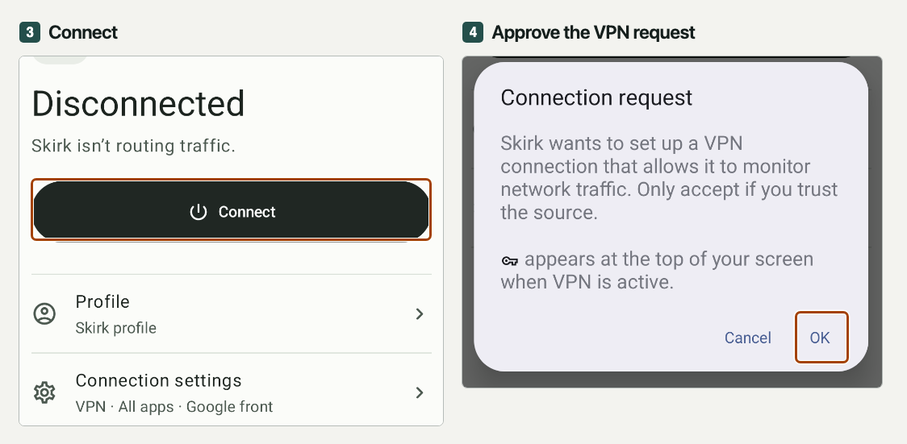

# نصب و راه‌اندازی اسکیرک

[English](install.md)

## راه‌اندازی خروجی

۱. در پروژهٔ شخصی گوگل، Drive API را فعال کنید، برنامهٔ OAuth را منتشر کنید و فایل JSON مربوط به **Desktop app** را بگیرید. همان حسابی را انتخاب کنید که قرار است مالک فایل‌های درایو باشد. [راهنمای تصویری گوگل](personal-google-setup.fa.md)

۲. روی دستگاهی که قرار است روشن بماند، برنامهٔ خط فرمان را نصب کنید. برای سرور لینوکس دستورهای زیر را اجرا کنید. محل نصب برای کاربر عادی `~/.local/bin` و برای کاربر ریشه `/usr/local/bin` است.

```sh
curl -fL https://raw.githubusercontent.com/ShahabSL/Skirk/v0.1.56/install.sh -o install-skirk.sh
sh install-skirk.sh --version v0.1.56
skirk version
```

۳. فایل دانلودشده را در یک پوشهٔ خصوصی روی خروجی با نام `oauth-client.json` ذخیره کنید و در همان پوشه دستورهای زیر را بزنید.

```sh
chmod 600 oauth-client.json
skirk setup init --oauth-client-file ./oauth-client.json --out skirk-kit
skirk service status
```

۴. پیوندی را که اسکیرک چاپ می‌کند باز کنید و دسترسی درایو را بدهید. اگر از SSH استفاده می‌کنید، ممکن است مرورگر در پایان یک نشانی localhost را باز نکند. **کل نشانی** را از نوار آدرس کپی کنید و در همان ترمینالی که منتظر پاسخ است جای‌گذاری کنید. این نشانی محرمانه است.

۵. فایل `skirk-kit/exit.json` را روی خروجی نگه دارید. متن کامل `skirk-kit/client.skirk` را از راهی خصوصی برای افرادی بفرستید که اجازهٔ استفاده از خروجی و دسترسی به صندوق درایو را دارند.

روی لینوکس، راه‌انداز می‌تواند سرویس systemd را نصب و اجرا کند. اگر سیستم شما systemd ندارد، به دستور راه‌اندازی `--start-exit=false` اضافه کنید. سپس خروجی را با `skirk serve-exit --config skirk-kit/exit.json` اجرا کنید و ترمینال را باز نگه دارید.

**خروجی روی مک یا ویندوز.** بستهٔ خط فرمان متناسب با سیستم‌عامل و پردازنده را بگیرید، مقدار SHA-256 را با `SHA256SUMS` تطبیق دهید و فایل را از حالت فشرده خارج کنید. در مک برنامه را با `./skirk` اجرا کنید. در ویندوز، PowerShell را در پوشهٔ فایل‌های استخراج‌شده باز کنید و این دو دستور را بزنید. [دانلود](https://github.com/ShahabSL/Skirk/releases/latest)

```powershell
.\skirk.exe setup init --oauth-client-file .\oauth-client.json --out skirk-kit --start-exit=false
.\skirk.exe serve-exit --config skirk-kit/exit.json
```

## اتصال گوشی یا رایانه

۱. برای اندروید می‌توانید APK با برچسب universal را بگیرید. برای دسکتاپ بستهٔ مخصوص سیستم‌عامل و پردازنده را انتخاب کنید. برای مک‌های سری M، نسخهٔ arm64 مناسب است. در آیفون از نسخه‌ای استفاده کنید که از طریق اپل به آن دسترسی دارید.

۲. پروفایل را از ابتدای `skirk:` تا آخر کپی کنید. در بخش ورود پروفایل، گزینهٔ جای‌گذاری را بزنید و آن را ذخیره کنید.

۳. پروفایل را انتخاب کنید و **Connect** را بزنید. در حالت VPN، درخواست سیستم‌عامل را تأیید کنید. در حالت پروکسی، نشانی پروکسی را در برنامهٔ موردنظر وارد کنید. با آزمون خروجی داخل اسکیرک بررسی کنید که ارتباط برقرار شده است.

| اندروید | آیفون | دسکتاپ |
| --- | --- | --- |
|  |  |  |



برای کلاینت بدون رابط گرافیکی، `skirk serve-client --config ./client.skirk` را اجرا کنید. در برنامهٔ مصرف‌کننده، پروکسی SOCKS5 را روی `127.0.0.1:18080` تنظیم کنید و در صورت امکان، حل نام را به پروکسی بسپارید.

## ظرفیت

در یکی از آزمایش‌های واقعی درایو، ۱۲۰ کاربر پشت یک دروازهٔ مشترک هرکدام یک فایل ۱ MiB فرستادند و گرفتند و یک درخواست HTTPS را کامل کردند. دو تماس هم‌زمان در همان آزمایش برقرار نشد. در آزمایشی جداگانه با هشت کاربر و دو تماس فعال، هر شانزده انتقال ۱۶ MiB کامل شد و مجموع سرعت رفت‌وبرگشت فایل‌ها ۷۳٫۳۳ مگابیت‌برثانیه بود. در ضعیف‌ترین جهت تماس، ۷۸٫۸٪ صدای اصلی و ۵۷٫۹٪ ویدیو در مهلت پخش ۱٫۵ ثانیه‌ای رسید. این عددها به بار کاری و شبکهٔ همان آزمایش مربوط‌اند.

کیت جدید UDP و DNS خروجی را فعال می‌کند. IPv6 پس از بررسی مسیر خروجی فعال می‌شود. تنظیم پیش‌فرض خروجی چهار مسیر مستقل UDP دارد و هر مسیر می‌تواند چند نشست را حمل کند. برای تخمین ظرفیت خودتان، هنگام انتقال فایل کیفیت تماس دریافتی و سهمیهٔ پروژه را بررسی کنید. [سهمیهٔ درایو](https://developers.google.com/workspace/drive/api/guides/limits)

## نگهداری

اگر دسترسی منقضی شد، پس از انتشار برنامهٔ OAuth با همان حساب و همان اعتبارنامه دسترسی را تمدید کنید، خروجی را دوباره راه بیندازید و پروفایل تازه را وارد کنید. [راهنمای تمدید](personal-google-setup.fa.md)

برای ارتقا از نسخه‌های قدیمی، خروجی و کلاینت‌ها را پیش از تغییر به mux v5 با هم به‌روز کنید. برای حذف اسکیرک در لینوکس ابتدا `skirk uninstall --dry-run` را اجرا کنید. اگر فهرست درست بود، با `skirk uninstall --yes` حذف را انجام دهید. از کیت موردنیازتان یک نسخهٔ پشتیبان خصوصی نگه دارید.
