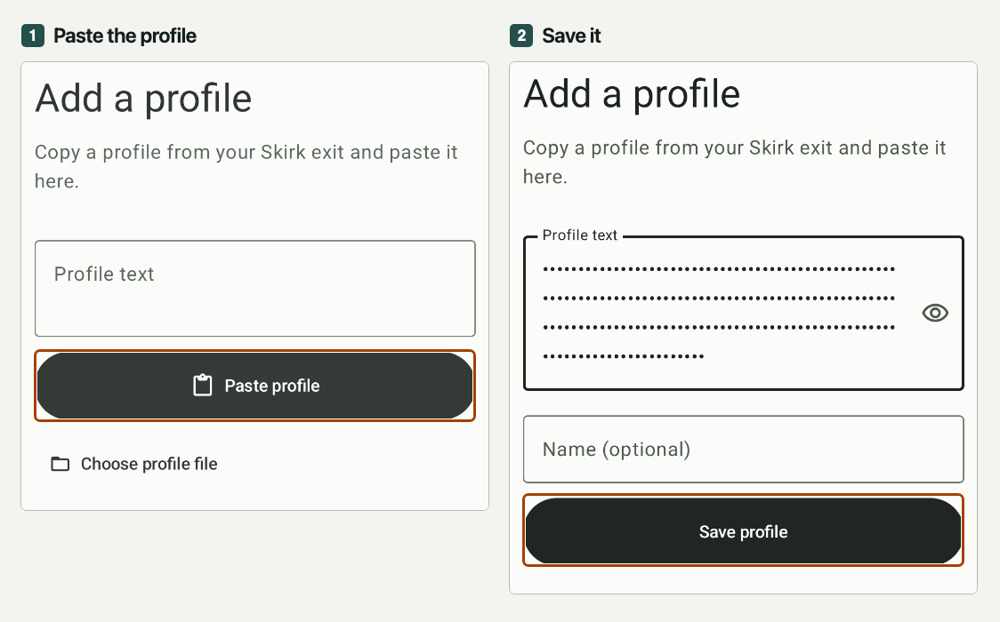
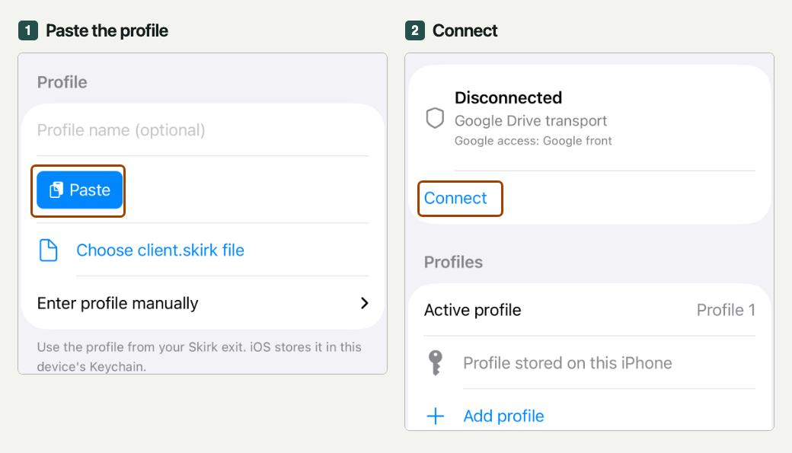
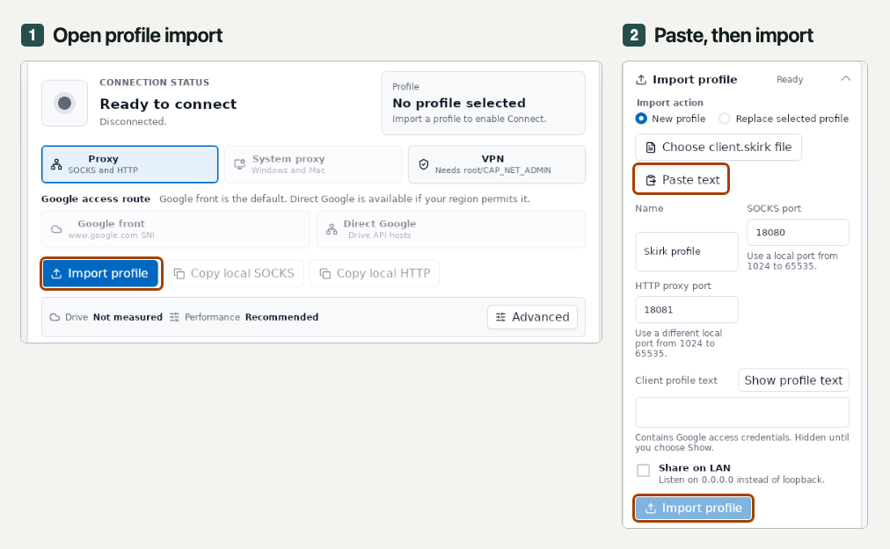
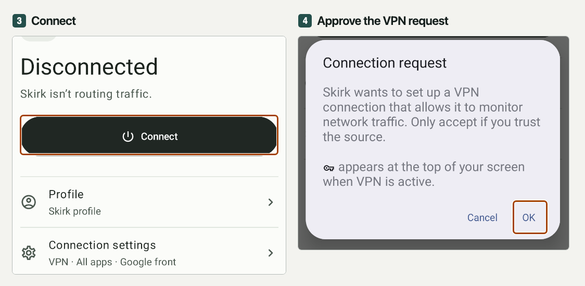

# Install Skirk

[فارسی](install.fa.md)

## Configure the exit

1. In a browser on your own computer, enable Drive in your Google project, publish the OAuth app, and create a **Desktop app** client. Leave the window showing **Client ID** and **Client secret** open. Only the person setting up the exit does this. [Illustrated Google setup](personal-google-setup.md)
2. Open a terminal on the computer that will stay online as the exit. If it is a remote server, connect to it using SSH. On Linux, install the CLI there. A regular user installs to `~/.local/bin`. Root installs to `/usr/local/bin`.

```sh
curl -fL https://raw.githubusercontent.com/ShahabSL/Skirk/v0.1.57/install.sh -o install-skirk.sh
sh install-skirk.sh --version v0.1.57
skirk version
```

3. In that terminal, start setup.

```sh
skirk setup init --out skirk-kit
```

4. At the credential menu, press Enter for **1. Paste**. Copy **Client ID** from Google, paste it at Skirk’s first prompt, and press Enter. At the next prompt paste **Client secret** and press Enter again. The secret stays hidden as you paste. Skirk creates the credential file on the exit.
5. Open the approval link from Skirk in your browser. Sign in with the Google account that will own the mailbox and approve Drive access. Over SSH, your browser may end on a localhost page that fails to load. Copy the **entire address** from the address bar and paste it into the waiting Skirk prompt. Keep that address private.
6. Keep `skirk-kit/exit.json` on the exit. In your private terminal, run `skirk` and choose **11. Show client profile and QR code**. Press Enter to use the suggested `client.skirk` file. On your phone, open the Skirk profile importer, choose **Scan QR code**, and point the camera at the terminal. You can also copy the full `skirk:` line into the app. Treat the code and the line like a password.

You can open the same view with `skirk config show --config skirk-kit/client.skirk`. If the terminal is too small, zoom out and run the command again. Add `--qr-out client-qr.png` to save a private PNG for the desktop app's **Open QR image** option. On v0.1.56, read the profile with `cat skirk-kit/client.skirk` or `Get-Content skirk-kit/client.skirk` in PowerShell, then paste it into the app.

On Linux with systemd, setup can install and start the exit service. Run `skirk service status` to check it. On a machine without systemd, or to run in the foreground, use `--start-exit=false` during setup and run `skirk serve-exit --config skirk-kit/exit.json` afterward. For additional instances, assign distinct kit directories and service names. [Service and configuration reference](setup.md)

**macOS and Windows exits.** Download the CLI archive for your OS and CPU and check its digest against `SHA256SUMS`. Extract it into a private folder under your user account and open a terminal there. Setup saves the credential file and kit in that folder. Run the setup command for your platform. After setup finishes, run the second command and leave that terminal open. [Downloads](https://github.com/ShahabSL/Skirk/releases/latest)

| Exit | Set up once | Run the exit |
| --- | --- | --- |
| macOS | `./skirk setup init --out skirk-kit --start-exit=false` | `./skirk serve-exit --config skirk-kit/exit.json` |
| Windows (PowerShell) | `.\skirk.exe setup init --out skirk-kit --start-exit=false` | `.\skirk.exe serve-exit --config skirk-kit/exit.json` |

## Connect a device

1. Install the Android APK or the desktop package for your operating system and CPU. Android's universal APK suits both supported mobile ABIs. On an Apple silicon Mac choose the arm64 build. On iOS, install a build to which you have access through Apple.
2. Open the profile import screen. Scan the QR code on Android or iOS, open a QR image on desktop, or paste the entire line starting with `skirk:`. Save the profile.
3. Select the profile and connect. Accept your operating system's VPN prompt when using VPN mode. In proxy mode, select the proxy in the application that will use it. Use the exit test to confirm that the profile reaches your exit.

| Android | iOS | Desktop |
| --- | --- | --- |
|  |  |  |



To share a saved profile, open its actions and choose **Share profile**. Show the QR code to someone you trust, or use **Copy profile** to send them the text privately.

A headless client can run `skirk serve-client --config ./client.skirk`. Point your application to SOCKS5 at `127.0.0.1:18080`. Select proxy-side DNS when the application offers it.

## Capacity

Devices sharing a profile use the same Google user's Drive quota. Each independent VPN client checks its own incoming traffic. When sizing a shared installation, count independent clients, how many need UDP at the same time, and whether each receives data in time for playback.

If Android shows **Google Drive is limiting requests**, open the Drive usage details to see the reason and remaining cooldown. Skirk pauses requests after Google returns a rate-limit response. Leave it connected while it waits. If this happens regularly, check the Drive API metrics for the exit’s Google Cloud project. Publishing the OAuth app addresses the Testing refresh-token expiry. Google documents its request quotas separately. [Drive API usage limits](https://developers.google.com/workspace/drive/api/guides/limits)

If Android shows **The exit is full for new UDP traffic**, the exit has filled its UDP carrier slots. An existing call can keep its slot while a newly started call waits for capacity. The Drive usage details and the UDP capacity message help identify which resource ran out.

For a shared UDP kit, you can test grouped polling by setting `tunnel.udp_preview_grouped_discovery` to `true` in the exit configuration and restarting the exit. The exit can then check up to four clients in one Drive list request. Compare call playback and the project's Drive usage under the same load before keeping the setting.

On iPhone, open **Drive usage**, select **Lower Drive usage**, then reconnect. Skirk saves the choice for this profile. It checks for TCP responses less often, which saves Drive requests but can make pages open more slowly. UDP keeps its own polling schedule. The displayed usage covers this iPhone. Other devices and the exit also consume the shared quota. [See the iPhone settings](images/ios-drive-usage.png)

Turn on **VPN disconnect alerts** to receive a notification when Skirk detects an unexpected stop. If iOS terminates the extension before it can send the alert, open Skirk to check the VPN status and reconnect.

Size your installation for the work people actually do. In one earlier live Drive run, 120 users behind a shared gateway each completed a 1 MiB upload, a 1 MiB download and an HTTPS request. Neither concurrent call connected in that run. In a separate eight-client run, all sixteen 16 MiB transfers completed alongside two ongoing calls. Combined file throughput was 73.33 Mb/s. In the weakest direction, 78.8% of original audio and 57.9% of video arrived for playback within 1.5 seconds. These measurements describe particular workloads and network conditions.

New kits enable UDP and exit DNS. Setup enables IPv6 when it verifies the exit route. The default exit allows four independent UDP carriers, each serving multiple sessions. A carrier, a UDP socket, and a human user are different units. Watch the Drive API metrics for the Google project and test received media during a transfer before increasing concurrency. [Google Drive quota](https://developers.google.com/workspace/drive/api/guides/limits)

## Maintenance

- **Expired authorization.** Publish your OAuth app, then renew with the same Google account and Desktop client. Restart the exit service and import the updated client profile. [Renewal instructions](personal-google-setup.md#renew-access-and-check-quota)
- **Upgrading from an older installation.** Coordinate the exit and client updates before switching to mux v5. [Migration guide](mux-v5-migration.md)
- **Uninstalling on Linux.** Run `skirk uninstall --dry-run` to review what will be removed. Use `skirk uninstall --yes` to proceed. Keep a private copy of any kit you want to reuse.
