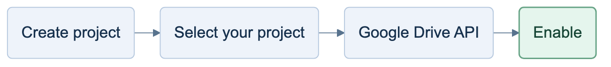
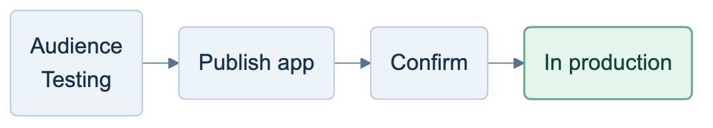
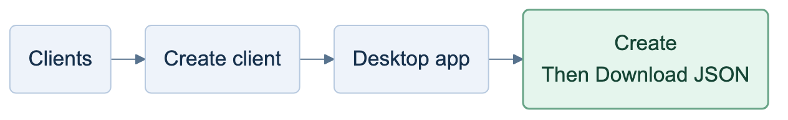

# راه‌اندازی اسکیرک با پروژهٔ شخصی گوگل

[English](personal-google-setup.md)

این مراحل را صاحب خروجی یک‌بار انجام می‌دهد. فایل‌های صندوق درایو به حسابی تعلق دارند که دسترسی می‌دهد و درخواست‌ها از سهمیهٔ پروژهٔ شما استفاده می‌کنند. افرادی که پروفایل را دریافت می‌کنند آن را مستقیماً در اسکیرک وارد می‌کنند.

## ۱. پروژه بسازید و درایو را فعال کنید



با حسابی که قرار است مالک صندوق باشد وارد Google Cloud شوید. **Create project** را بزنید و یک نام انتخاب کنید. در انتخابگر پروژه همان پروژه را باز کنید. در صفحهٔ **Google Drive API** دکمهٔ **Enable** را بزنید. باقی مراحل را در همین پروژه انجام دهید. [ساخت پروژه](https://console.cloud.google.com/projectcreate) · [فعال‌سازی Drive API](https://console.cloud.google.com/apis/library/drive.googleapis.com)

## ۲. دسترسی را مشخص کنید


۱. در **Google Auth Platform → Branding** اگر **Get started** را دیدید آن را بزنید. یک نام برای برنامه و یک ایمیل پشتیبانی وارد کنید. برای حساب شخصی در بخش مخاطبان **External** را انتخاب کنید. ایمیل تماس را وارد کنید و شرایط گوگل را بخوانید. [Branding](https://console.cloud.google.com/auth/branding)

۲. در **Data Access → Add or Remove Scopes** دسترسی `https://www.googleapis.com/auth/drive.file` را انتخاب کنید و **Update** و سپس **Save** را بزنید. اگر در فهرست نبود، فعال بودن Drive API را بررسی کنید و در صورت نیاز از **Manually add scopes** استفاده کنید. اسکیرک با این دسترسی فایل‌های صندوق خودش را مدیریت می‌کند. [Data Access](https://console.cloud.google.com/auth/scopes) · [توضیح دسترسی‌ها](https://developers.google.com/workspace/drive/api/guides/api-specific-auth)


## ۳. برنامه را پیش از ورود منتشر کنید



در **Audience** وضعیت **Publishing status** را ببینید. اگر **Testing** است، **Publish app** و سپس **Confirm** را بزنید تا **In production** نمایش داده شود. سپس به اسکیرک اجازهٔ دسترسی بدهید. مجوز درایو که در حالت آزمایشی صادر می‌شود پس از هفت روز منقضی می‌شود. انتشار برنامه این علت انقضا را برطرف می‌کند. لغو دسترسی، استفاده‌نکردن طولانی یا تغییر سیاست حساب هنوز می‌تواند باعث منقضی‌شدن مجوز شود. [Audience](https://console.cloud.google.com/auth/audience) · [شرایط انقضای گوگل](https://developers.google.com/identity/protocols/oauth2#expiration)


انتشار، مخاطبان مجاز را تغییر می‌دهد. اگر گوگل برای برند یا تأیید پروژه مدرک بیشتری درخواست کرد، مراحل همان پروژه را دنبال کنید. جریان ورود Desktop از نشانی محلی استفاده می‌کند و برای بازگشت مرورگر به برنامه به دامنهٔ عمومی نیاز ندارد. [شرایط استفادهٔ شخصی](https://support.google.com/cloud/answer/13464323) · [ورود برنامه‌های Desktop](https://developers.google.com/identity/protocols/oauth2/native-app)

## ۴. فایل Desktop app را بگیرید



در **Clients → Create client**، نوع **Desktop app** را انتخاب کنید. نامی وارد کنید و **Create** را بزنید. همان موقع JSON را دانلود کنید و با نام `oauth-client.json` در پوشه‌ای خصوصی روی خروجی ذخیره کنید. [Clients](https://console.cloud.google.com/auth/clients)


## ۵. خروجی را راه‌اندازی کنید

از پوشهٔ حاوی JSON دستور راه‌اندازی را اجرا کنید. در SSH، اگر مرورگر نشانی محلی نهایی را باز نکرد، کل نشانی را در همان درخواست ترمینال جای‌گذاری کنید. فایل JSON، نشانی بازگشتی و پروفایل را محرمانه نگه دارید. [دستورهای نصب و ورود پروفایل](install.fa.md)

## تمدید مجوز

اگر خطای `invalid_grant` می‌بینید یا کیت را در حالت آزمایشی ساخته‌اید، ابتدا وضعیت را به **In production** تغییر دهید. در پوشهٔ خروجی با همان حساب و همان Desktop client دستور زیر را اجرا کنید. پس از تمدید، سرویس را دوباره راه‌اندازی و پروفایل به‌روزشده را در کلاینت‌ها وارد کنید. پوشهٔ درایو و هویت تونل حفظ می‌شوند.

```sh
skirk setup renew-oauth --kit skirk-kit --oauth-client-file ./oauth-client.json
```
