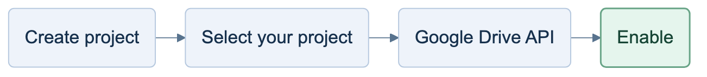
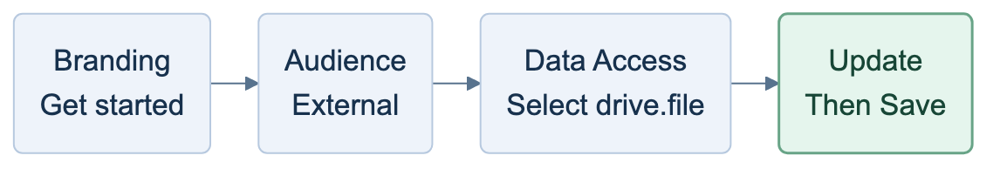
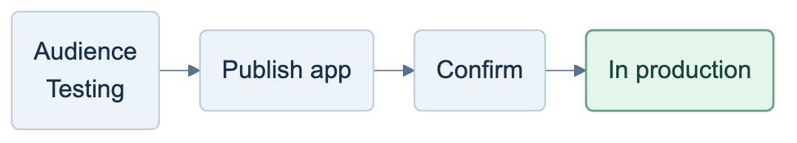
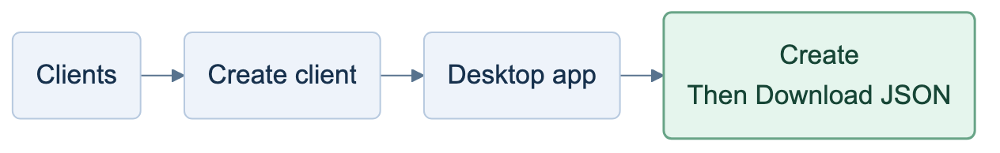

# Set up Skirk with your Google Cloud project

[فارسی](personal-google-setup.fa.md)

Set up Google once for the exit. The Google account you authorize owns the Drive mailbox, and Drive API usage counts against your project's quota. People you share the Skirk client profile with import it in their Skirk app. Google sign-in happens during exit setup.

The illustrated steps show the controls to use with generic labels.

## 1. Create a project and enable Drive



1. Sign in to Google Cloud with the account that will own the mailbox. Enter a project name such as **Skirk Personal**, then click **Create**. [Create a project](https://console.cloud.google.com/projectcreate)
2. Select that project using the project picker. Open **Google Drive API** and click **Enable**. [Google Drive API](https://console.cloud.google.com/apis/library/drive.googleapis.com)

Use the same project for every Console step below.

## 2. Configure consent and Drive access




1. Under **Google Auth Platform → Branding**, click **Get started** if prompted. Enter an app name, choose your **User support email**, and click **Next**. [Branding](https://console.cloud.google.com/auth/branding)
2. Choose **External** for a personal Google account. Enter a contact email, review Google's policy, and finish creating the configuration if you agree. **Internal** is for apps limited to an eligible Google Workspace or Cloud Identity organization. [Google's consent setup guide](https://developers.google.com/workspace/guides/configure-oauth-consent)
3. Open **Data Access → Add or Remove Scopes**. Select `https://www.googleapis.com/auth/drive.file`, click **Update**, then **Save**. If it is missing from the list, confirm that Google Drive API is enabled in the selected project or use **Manually add scopes**. Skirk uses this per-file scope to create and manage its mailbox files. Google classifies it as non-sensitive. [Data Access](https://console.cloud.google.com/auth/scopes) · [Scope selection](https://support.google.com/cloud/answer/15549135) · [Drive scopes](https://developers.google.com/workspace/drive/api/guides/api-specific-auth)

## 3. Publish before signing in




Open **Audience** and check **Publishing status**. While it shows **Testing**, click **Publish app**, click **Confirm**, and check that the status changes to **In production**. [Audience](https://console.cloud.google.com/auth/audience) · [Google's published screenshot of the Publish app control](https://developers.google.com/static/google-ads/api/images/brand-verification/3a_consumer-publish-app.png)

**The seven-day expiry starts when you authorize Drive access while an External app is in Testing.** Authorize the kit after the project shows **In production** to avoid that Testing-specific expiry. Google can still invalidate a refresh token after revocation, long inactivity, or policy changes. [Publishing status](https://support.google.com/cloud/answer/15549945) · [Refresh token expiration](https://developers.google.com/identity/protocols/oauth2#expiration)

Publishing and verification are separate. Google describes a verification exception for limited personal use. Follow any verification or branding requirements shown for your project. Publishing changes who can authorize the app. Google's Drive data-use policies still apply. [Personal-use verification guidance](https://support.google.com/cloud/answer/13464323) · [Workspace developer policy](https://developers.google.com/workspace/workspace-api-user-data-developer-policy)

## 4. Create a Desktop app client




Open **Clients → Create client**. Set **Application type** to **Desktop app**, enter a name, and click **Create**. Download the JSON when the credential is created and save it as `oauth-client.json`. Google shows the full secret when it is created, so keep the original JSON in a private directory or secret store. [Clients](https://console.cloud.google.com/auth/clients) · [Google's client secret guidance](https://support.google.com/cloud/answer/15549257)

## 5. Create the Skirk kit

After installing Skirk, put the JSON in a private directory on the exit machine. On Linux and macOS, run `chmod 600 ./oauth-client.json` from that directory. On Windows, use a directory accessible only to your Windows account. Run setup from that directory and choose a fresh output path. To recover an existing kit, use renewal below.

```sh
skirk setup init --oauth-mode personal --oauth-client-file ./oauth-client.json --out skirk-kit --start-exit=false
```

On Windows, use the path to `skirk.exe` if it is outside `PATH`.

1. Open the Google approval URL printed by Skirk and approve access with the account that will own the mailbox.
2. When running setup over SSH, Google may redirect your browser to a local address it cannot reach. Copy the entire address from the browser address bar into the same Skirk prompt. On the machine running Skirk, the browser can complete the loopback callback directly. Treat the callback URL as a credential. [Google's desktop authorization flow](https://developers.google.com/identity/protocols/oauth2/native-app)
3. Start the exit using its generated `skirk-kit/exit.json`. For a foreground exit, run `skirk serve-exit --config skirk-kit/exit.json`. For a background service and client import, follow the [installation guide](install.md#configure-the-exit).

Keep `oauth-client.json` and `exit.json` private. Treat `skirk-kit/client.skirk` as a password because it contains the credentials needed to use your mailbox. Send it privately only to people you trust. Keep all these files, OAuth callback links, and tokens out of Git, screenshots, and shared logs.

## Renew access and check quota

- **Already authorized in Testing or seeing `invalid_grant`.** Check that the project shows **In production**, then renew the existing kit with `skirk setup renew-oauth --kit skirk-kit --oauth-client-file ./oauth-client.json`. Use the same Google account and OAuth client ID. Restart the exit and import the renewed `client.skirk` on clients whose grant has expired. Renewal keeps the existing tunnel and mailbox. [Skirk renewal details](setup.md#renew-an-expiring-personal-oauth-grant)
- **Google says the app is being tested.** For a long-running kit, publish the project first and authorize again. To run a short test in **Testing**, add the exact signing-in account under **Audience → Test users**. Access granted there will still expire after seven days. [Google's audience guidance](https://support.google.com/cloud/answer/15549945)
- **Do I need a domain?** The Desktop app flow uses a loopback callback. The exit can use this flow without a public callback URL. If Google asks for a domain for branding or verification, follow the requirements shown for your project. [Desktop callbacks](https://developers.google.com/identity/protocols/oauth2/native-app#redirect-uri_loopback) · [Google branding guidance](https://support.google.com/cloud/answer/15549049)
- **Estimating capacity for family or friends.** Check the Drive API quota for your project. Google applies limits per project and per user within the project. Devices using the same kit use the mailbox owner's Google authorization. Concurrent usage depends on traffic and API costs, so the project quota is a starting point for testing capacity. [Drive API usage limits](https://developers.google.com/workspace/drive/api/guides/limits)
